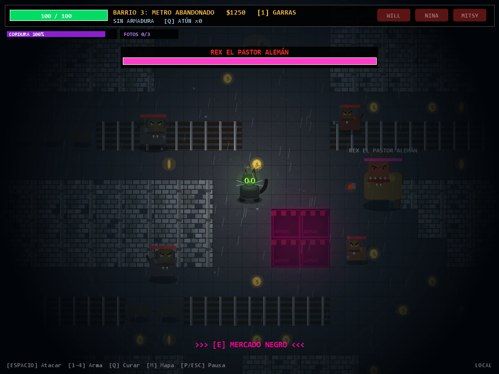
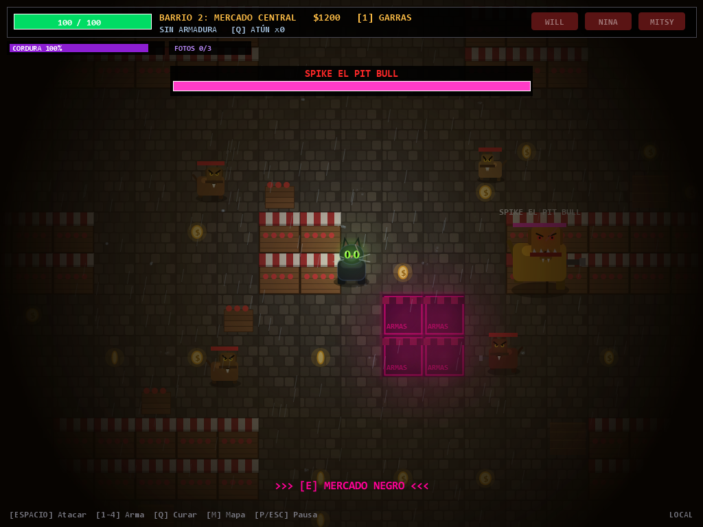
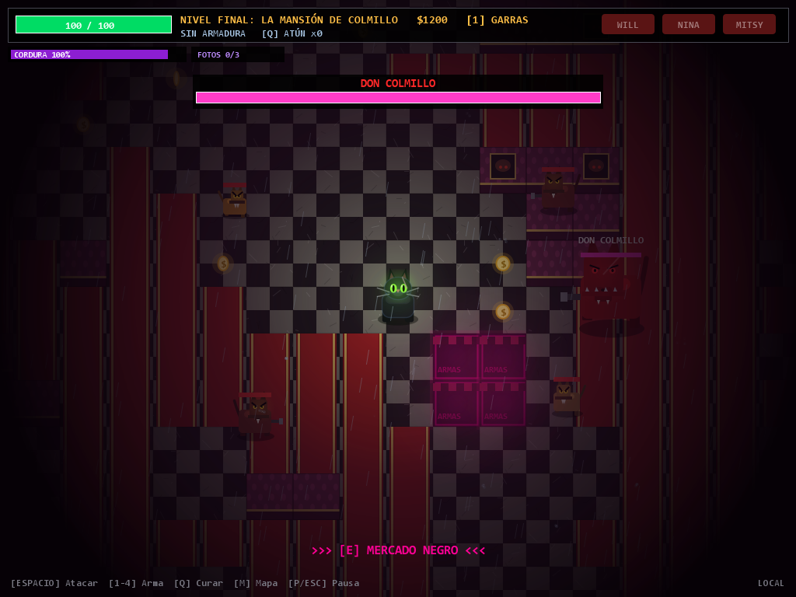

# ÉXODO: LA VENGANZA DE NOX

Juego de **terror y acción en 2D** hecho en Java, sobre un gato callejero que cruza seis barrios de una ciudad dominada por perros para rescatar a su familia.



---

## De qué va

Nox es un gato negro que por fin tenía una vida tranquila con su esposa Mitsy y sus dos gatitos, Will y Nina, en un callejón detrás del mercado.

Pero la ciudad tiene dueño: una pandilla de perros liderada por **Don Colmillo** cobra "protección" a todos los animales. Nox se negó a pagar. Esa misma noche ardió el callejón y su familia desapareció.

Ahora tiene que cruzar **seis barrios**, derrotar al jefe de cada uno y recuperar a los suyos.

---

## Lo que lo hace distinto

**No hay ni una imagen ni un archivo de sonido en el proyecto.** Los gráficos se dibujan con figuras geométricas de Java 2D y el audio se genera calculando ondas sonoras en el momento. El juego se copia a una USB y funciona igual en cualquier ordenador, sin carpetas de recursos que se puedan perder.

**La cordura decide el final.** Hay una barra que baja al estar cerca de los perros y al recibir sustos. No mata: lo que hace es cerrarte la visión, hasta dejarte viendo apenas dos casillas alrededor. Y cuando baja del 68%, el juego **empieza a mentirte**: aparecen perros que no existen, se oyen pasos a tu espalda y hasta la barra de vida marca números falsos. Con la cordura por debajo del 45% al derrotar a Colmillo, se desbloquea un **final distinto**.

**Cada barrio se construye con su propio algoritmo**, así que no se repiten: montañas de basura, puestos de mercado, túneles de metro con vías, contenedores junto al agua, azoteas separadas por el vacío y los salones de una mansión.

| | |
|---|---|
|  |  |

---

## Características

- **6 barrios** generados al azar, cada uno con su terreno, sus materiales y su jefe
- **6 jefes**, cada uno con un ataque propio que usa el terreno de su zona, y una segunda fase al bajar de media vida
- **7 tipos de enemigo**: callejeros, armados, corredores, brutos, con escudo, alfas que llaman refuerzos y kamikazes
- **5 armas**, 3 niveles de armadura y una tienda donde gastar lo que recojas
- **2 finales**, decididos por la cordura con la que llegues al final
- **25 logros**, cuatro de ellos secretos
- **Cinemáticas** dibujadas para el prólogo y los dos finales
- **10 sustos** distintos que nunca se repiten seguidos, con aviso, golpe y resaca
- **Audio estéreo posicional**: los ladridos se oyen por el lado por el que vienen
- Soporte para **mando de Xbox**, con vibración
- **Opciones de accesibilidad**: se pueden apagar los sustos, los destellos, el temblor y la vibración

---

## Cómo jugar

### La forma fácil

Descarga el `.zip` de la sección **[Releases](../../releases)** de este repositorio, descomprímelo y haz doble clic en **`JUGAR.bat`**.

**No hace falta instalar Java**: el ejecutable lleva dentro su propia copia.

### Desde el código

Necesitas el **JDK 17 o superior** ([Adoptium](https://adoptium.net/)). Para el mando hace falta Java 22+.

```bash
git clone https://github.com/emi0000000/juego.git
cd juego
javac -encoding UTF-8 -cp ".;flatlaf-3.4.1.jar" *.java
java --enable-native-access=ALL-UNNAMED -cp ".;flatlaf-3.4.1.jar" ProjectExodusAdvanced
```

En Linux o Mac, cambia el `;` del classpath por `:`.

O simplemente haz doble clic en **`JUGAR.bat`**, que compila y arranca solo.

### Generar el ejecutable

```bash
CREAR-EJECUTABLE.bat
```

Crea `Exodo.jar` (un solo archivo, necesita Java) y `ejecutable\Exodo.exe` (lleva Java dentro, no necesita nada). Usa `jpackage`, que viene con el JDK 14+.

---

## Controles

| Teclado | Mando | Acción |
|---|---|---|
| `W A S D` / flechas | Stick izq. o cruceta | Mover |
| `ESPACIO` | `A` o gatillo derecho | Atacar |
| `1` `2` `3` `4` | `LB` / `RB` | Cambiar de arma |
| `Q` | `X` | Comer lata de atún |
| `F` | `Y` | Silbato ultrasónico |
| `E` | `B` | Mercado Negro |
| `M` | `BACK` | Mapa del barrio |
| `P` / `ESC` | `START` | Pausa |
| `F11` | — | Pantalla completa |

---

## Cómo está hecho

| | |
|---|---|
| **Lenguaje** | Java (98%) · Python (2%, servidor opcional) |
| **Interfaz** | Swing + Java 2D |
| **Gráficos** | Dibujados con código, sin imágenes |
| **Audio** | Sintetizado con `javax.sound.sampled`, sin archivos de sonido |
| **Mando** | XInput, llamado desde Java puro con `java.lang.foreign` |
| **Dependencias** | Una sola: [FlatLaf](https://www.formdev.com/flatlaf/) 3.4.1 (tema oscuro) |
| **Pruebas** | 61 pruebas automáticas (`SmokeTest.java`) |

Unas **8.300 líneas de Java**. No usa ningún motor de videojuegos: el bucle de juego, las colisiones, la generación de mapas, el dibujo y el audio están escritos a mano.

```bash
java --enable-native-access=ALL-UNNAMED -cp ".;flatlaf-3.4.1.jar" SmokeTest
```

---

## Documentación

| Documento | Qué explica |
|---|---|
| [HISTORIA.md](HISTORIA.md) | La historia, los barrios, los jefes, las armas y los dos finales |
| [GUIA.md](GUIA.md) | Cómo se consiguen los 25 logros, cada final y dónde están los secretos |
| [COMO_EJECUTAR.md](COMO_EJECUTAR.md) | Instalación paso a paso en un ordenador nuevo |
| [MOTORES.md](MOTORES.md) | Cómo funcionan los motores: bucle, dibujo, audio, mando |
| [CODIGO.md](CODIGO.md) | Detalle técnico archivo por archivo |
| [ARCHIVOS.md](ARCHIVOS.md) | Qué es y de qué se encarga cada archivo |

---

## Servidor opcional

`server.py` guarda el progreso y una tabla de récords. **El juego funciona perfectamente sin él.**

```bash
pip install fastapi uvicorn
uvicorn server:app --reload
```

Si está apagado, el juego ni se entera: la sincronización va en un hilo aparte con 900 ms de espera máxima.

---

## Licencia

Proyecto escolar. [FlatLaf](https://www.formdev.com/flatlaf/) se distribuye bajo licencia Apache 2.0.
